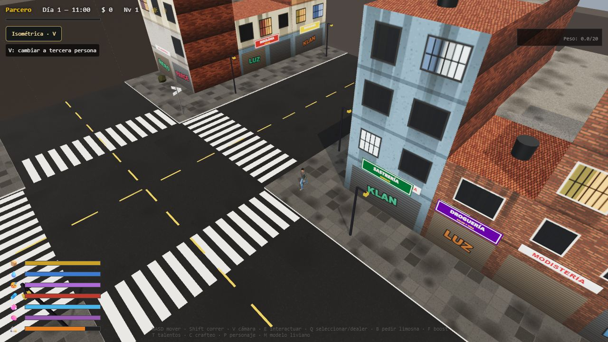
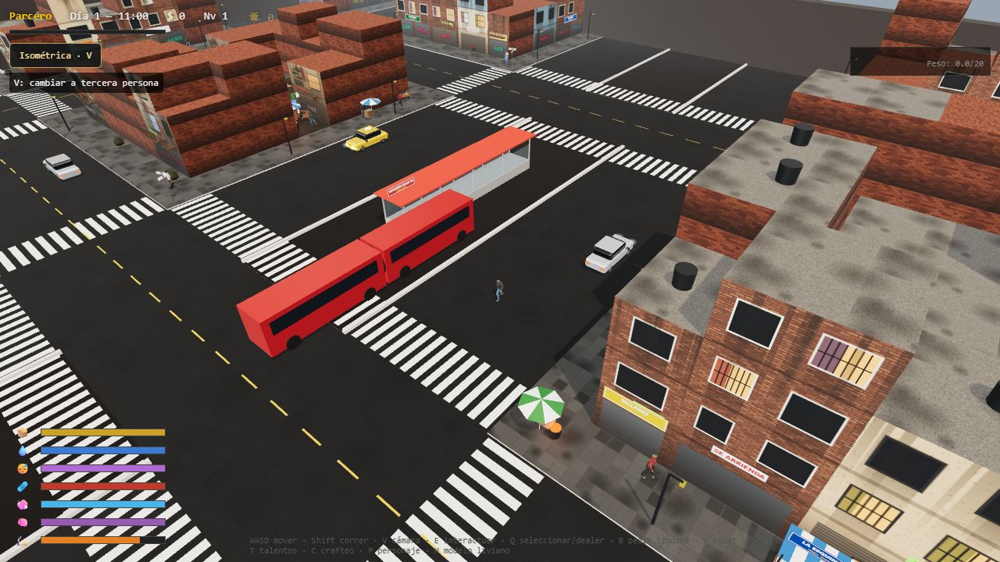
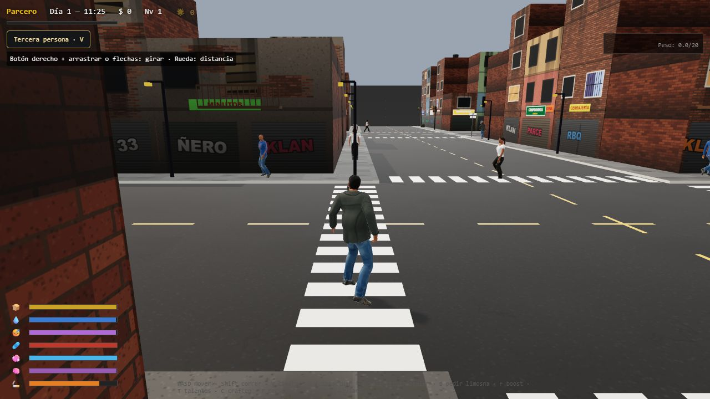

# Vagabundo

Juego de supervivencia urbana en 3D para el navegador, ambientado en un barrio inspirado en el centro de Bogotá, Santa Inés y El Cartucho. Explora las calles, recoge y vende materiales, consigue comida y agua y mejora tu cambuche.

Este proyecto es un fork de [juanagogo/bazuko](https://github.com/juanagogo/bazuko), con mejoras de cámara, visibilidad, circulación y equilibrio de supervivencia.



## Características

- Integración experimental en `pruebas-integracion`: carriles rojos con SOLO BUS, estación, semáforos que regulan el tráfico, inventario por casillas y modelos de bolsas, canecas, lámparas, carros, taxi, TransMilenio y cambuche del fork de [mreyeswilson](https://github.com/mreyeswilson/bazuko). [Detalles de integración y procedencia](docs/modelos-importados.md).
- Cámaras en tercera persona e isométrica, intercambiables durante la partida.
- Techos y paredes que se ocultan cuando tapan al personaje en vista isométrica, con muros bajos y silueta del jugador.
- Peatones que caminan por los andenes y cruzan las calles.
- Carros y taxis con recorridos aleatorios entre 90 alternativas transitables y un bus articulado que circula por la troncal y para en la estación.
- Calzadas de 12 metros y andenes de 4 metros.
- Ciudad de 240 × 222 metros: tres veces la superficie inicial, con barrios nuevos al oriente y al sur, dos calles y dos carreras adicionales y dos parques nuevos.
- Creación de personaje, inventario, reciclaje, comercio, talentos y construcción del cambuche.
- Ciclo de día y noche y necesidades de supervivencia con un ritmo relajado. Un día del juego dura una hora real.
- Panel de FPS actuales, mínimos, máximos, promedio y coordenadas X, Y, Z.
- Pantalla de carga con precarga de personajes, texturas y shaders antes de iniciar la partida y la medición de FPS.
- Descarte de sectores fuera de cámara, geometría agrupada, iluminación limitada y resolución adaptable para reducir el trabajo de renderizado.

## Capturas

### Carros, taxis y bus articulado



### Cámara en tercera persona



Las capturas están guardadas dentro del repositorio, en [`docs/images`](docs/images), y se muestran directamente en GitHub mediante enlaces relativos.

## Ejecutar en el navegador

Necesitas Node.js 22.12 o posterior, npm, Git y Git LFS. Los archivos de audio se distribuyen con Git LFS.

```sh
git lfs install
git clone https://github.com/GrandaCoder/Vagabundo.git
cd Vagabundo
git lfs pull
npm ci
npm run dev
```

Abre la dirección que indique Vite en la terminal, normalmente **http://localhost:5173**. Si ese puerto está ocupado, Vite elegirá otro.

En la primera partida se abre el creador de personaje. El juego se sirve con Vite; para ejecutarlo utiliza el servidor de desarrollo en lugar de abrir `index.html` directamente.

En PowerShell, si una política de ejecución impide usar `npm`, ejecuta los mismos comandos con `npm.cmd`.

## Controles

| Tecla o acción | Función |
| --- | --- |
| `W`, `A`, `S`, `D` | Moverse. En tercera persona, el movimiento sigue el rumbo de la cámara. |
| `Shift` | Correr. |
| `V` o botón de cámara | Alternar entre tercera persona e isométrica. |
| Botón derecho + arrastrar o flechas | Girar la cámara en tercera persona. |
| Rueda del ratón | Ajustar la distancia de la cámara en tercera persona. |
| `I` / `Tab` o botón Inventario | Abrir el inventario por casillas; el mundo queda en pausa. |
| `1`–`5` | Asignar el objeto seleccionado a acceso rápido mientras el inventario está abierto; usarlo cuando está cerrado. |
| `Enter`, `X`, `R` en el inventario | Usar, tirar una unidad (Mayús: todo), ordenar. |
| `E` | Interactuar con el objetivo cercano. |
| Mantener y soltar `Q` junto a basura | Seleccionar materiales y recogerlos al soltar. |
| `Q` junto al dealer | Abrir su tienda. |
| `B` o `L` | Pedir limosna. |
| `F` | Activar o desactivar el boost, que consume energía y salud. |
| `T` | Abrir talentos. |
| `C` | Abrir fabricación. |
| `P` | Editar el personaje. |
| `M` | Alternar entre el personaje realista y el modelo liviano. |
| `Esc` | Cerrar paneles y menús que permitan salir. |
| Clic en comida o bebida del inventario | Consumir el objeto. |

## Cómo empezar

Los materiales del cambuche aparecen en bolsas de basura repartidas por nueve zonas de la ciudad. Cada conjunto de bolsas reserva al menos **8 cartones, 8 tablas, 6 latas, 1 lona, 1 colchón y 1 vela**, además del botín aleatorio. Los cartones y las latas son comunes, las tablas poco comunes, la lona y la vela raras, y el colchón muy raro. Las bolsas vaciadas se reponen tras 20 segundos y conservan su reserva de materiales para que venderlos, perderlos o usarlos no bloquee la construcción. Si el costal está lleno, lo que no cabe permanece en esa bolsa; recogerlo de nuevo no vuelve a sortear su contenido. Las rarezas aparecen al recoger materiales y al pasar el cursor sobre el inventario o los requisitos de construcción.

1. Recorre los andenes y acércate a los objetos para ver las acciones disponibles.
2. Recoge materiales y véndelos en la recicladora para conseguir dinero.
3. Compra comida y agua y consúmelas desde el inventario.
4. Construye y mejora el cambuche para poder descansar.

La partida guarda datos localmente en el navegador al crear o editar el personaje y al dormir. La preferencia de cámara también se conserva. Los datos dependen del navegador y de la dirección desde la que juegas; no hay sincronización entre dispositivos.

Al cruzar delante de un carro, este intenta frenar progresivamente. Si te atraviesas demasiado cerca, puede atropellarte: el daño depende de la velocidad y puede ser mortal. El golpe activa un ragdoll articulado y lanza al personaje hacia arriba y hacia delante según la velocidad. Si sobrevive, se levanta después de caer; si muere, la pantalla de recuperación espera a que termine la caída. El conductor sigue frenando hasta detenerse y espera brevemente antes de continuar. Los vehículos en movimiento y estacionados tienen colisiones mediante cajas invisibles simples, sin calcular los triángulos de sus modelos.

Si la salud llega a cero, el juego se pausa y muestra una pantalla de recuperación. El regreso al cambuche ocurre al pulsar **Volver al cambuche**.

## Rendimiento

Al abrir el juego aparece una pantalla de carga por etapas. Espera el mapa, los modelos de jugador y NPC (incluidas sus versiones de detalle), sube las texturas a la GPU y precompila los materiales. Prepara también las sombras y la silueta de la vista inicial antes de mostrar la partida. El creador de personaje sigue disponible en la primera partida. Durante la carga no avanzan el reloj ni las necesidades; la medición de FPS comienza desde cero al entrar a jugar. Si falla un recurso imprescindible, aparece **Reintentar**; los sonidos ausentes no bloquean el inicio. Esta preparación aumenta la espera inicial y el uso de memoria al adelantar la carga de los NPC completos.

El panel inferior derecho muestra FPS actuales, mínimo y máximo por fotograma, promedio de la sesión, milisegundos por cuadro y coordenadas del jugador en metros. **Reiniciar medición** inicia una nueva muestra. El promedio se calcula como cuadros / tiempo real; los menús y la pestaña en segundo plano quedan excluidos. El panel se refresca cuatro veces por segundo para evitar escrituras DOM innecesarias.

La ciudad conserva sus dimensiones y población. La iluminación combina dos luces puntuales cercanas con halos decorativos suaves sobre el suelo para faroles y fogones. Hasta 48 halos cercanos comparten una sola llamada de dibujo y no calculan iluminación ni sombras sobre los materiales. Las llamas y lámparas siguen visibles; las luces decorativas lejanas ya no iluminan paredes y personajes en tiempo real.

Los suelos, marcas y edificios se agrupan por sectores de 32 metros. En tercera persona, las paredes, techos y adornos que comparten material se dibujan juntos; al cambiar a isométrica se recuperan las piezas independientes para ocultar las que tapan al jugador. Las transformaciones de inmuebles se calculan una vez. Las pasadas de silueta solo recorren al jugador y las luces, y el tráfico descarta peatones lejanos antes de comprobar el frenado.

El *frustum culling* descarta sectores completos y vehículos fuera del encuadre antes de recorrer sus mallas. Comprueba el volumen completo para conservar objetos parcialmente visibles y funciona en ambas cámaras. Los objetos necesarios para el mapa de sombras siguen disponibles en esa pasada; Three.js descarta sus mallas fuera de la cámara en la pasada de color. El bus y los NPC siguen su recorrido fuera de pantalla. Los halos también se filtran antes de crear las instancias. El panel muestra **Grupos en cámara** y **Descartados**; los grupos conservados únicamente para sombras explican la diferencia entre ambos contadores y el total.

Si los FPS permanecen por debajo de 45 durante tres segundos, la resolución interna baja gradualmente hasta 0.75×. Se recupera después de doce segundos por encima de 57 FPS, hasta el límite del dispositivo (máximo 1.5×). Esto puede suavizar la imagen en equipos lentos; el texto de la interfaz conserva su resolución. El panel también muestra la resolución actual, llamadas de dibujo y triángulos, incluyendo las pasadas de sombras y silueta. Los FPS reales dependen del equipo y deben compararse recorriendo la misma zona y con la misma cámara.

Referencias técnicas: [renderizado y métricas de Three.js](https://threejs.org/docs/pages/WebGLRenderer), [resolución de renderizado](https://threejs.org/manual/pages/responsive.html), [volumen visible de la cámara](https://threejs.org/docs/pages/Frustum.html).

## Sonido

El ambiente usa `city_atmosphere_soun.wav` y los pasos usan `Sounds_of_a_steps.wav`, con mayor cadencia al correr. Cada carro y el bus mantienen voces independientes para ralentí, marcha y claxon. Por ahora motores y claxon usan reproducción normal, sin audio espacial, paneo ni atenuación por distancia. El volumen depende de la marcha o el ralentí y permanece igual al girar la cámara. Solo suenan los ocho vehículos más cercanos a menos de 55 metros; las grabaciones se cargan una sola vez y se comparten entre instancias. El claxon utiliza una pitada corta de car_horn_sound1.wav, car_horn_sound.wav o car_horn_sound_v3.wav, espera ante peatones atravesados y tiene un intervalo propio de 6–11 segundos. Los semáforos y las colas de vehículos no lo activan por sí solos; si alguien se queda junto al parachoques, el conductor pita incluso estando detenido por rojo o tráfico. Menús, sueño y pestaña oculta pausan el audio; un clic o una tecla desbloquea el sonido si el navegador lo exige.

## Compilación y pruebas

Para generar la versión de producción y verla localmente:

```sh
npm run build
npm run preview
```

La compilación se genera en `dist/`. Abre la dirección que muestre el comando de previsualización.

Para ejecutar las pruebas con el runner de Node.js:

```sh
node --experimental-test-module-mocks --test tests/*.test.js
```

Las 134 pruebas actuales cubren colisiones, cámaras, visibilidad de edificios, suelos, navegación de peatones, tráfico, bus, supervivencia, migración de partidas guardadas, ampliación de la ciudad, rendimiento y carga inicial. Los carros circulan a 10–14 m/s en rectas libres (el doble que antes); el bus conserva sus 5 m/s y los semáforos completan su ciclo en 36 segundos, con 14 segundos de verde por eje, 3 de amarillo y 1 de despeje. El tráfico permite cruces simultáneos compatibles, mantiene la prioridad entre giros que se cortan y usa aceleración, frenado y reacción progresivos. Se comprueba su circulación durante diez minutos simulados, además del paso compartido con el bus y la carrocería dentro de la calzada al girar. Las pruebas de arranque verifican que la partida espere modelos, shaders y GPU, que un fallo impida comenzar una partida incompleta y que la espera no contamine las estadísticas de FPS. Las pruebas de modelos importados comprueban las dimensiones de los nueve GLB reales, el uso compartido de recursos, el desvanecimiento del bus y los estados de construcción del cambuche. La reserva de materiales se comprueba contra todas las recetas, también tras reponerse las bolsas, con protección de objetos cuando el costal está lleno.

## Estructura

```text
src/
  core/        Bucle del juego, renderizado, cámara y entrada
  entities/    Jugador y objetos interactivos
  systems/     Supervivencia, inventario, tráfico, guardado y colisiones
  world/       Distrito, edificios, terreno y navegación
  character/   Modelos y apariencia del personaje
  ui/          Interfaz, menús y creador de personaje
  data/        Objetos, talentos y construcción
public/        Modelos y audio
tests/         Pruebas automatizadas
docs/images/   Capturas del juego
```

## Tecnologías

JavaScript con módulos ES, Three.js para el mundo 3D, Vite para desarrollo y compilación y Howler para el audio.
